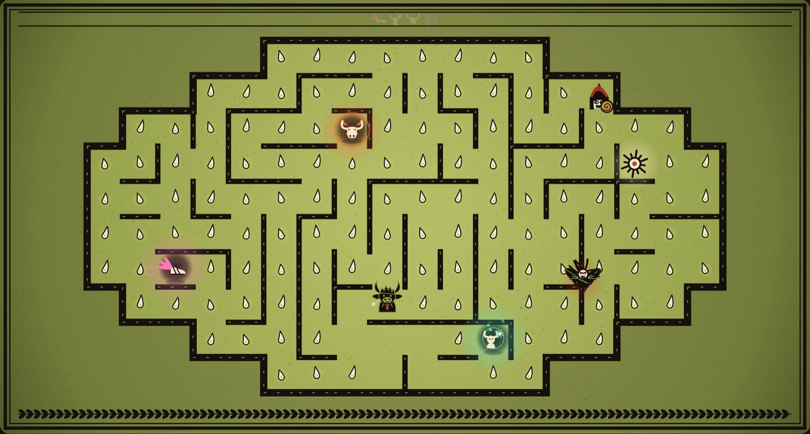

# Lantern Labyrinth

Lead the Minotaur out of the labyrinth with a lantern, past King Minos's wardens and a Fury sent by the gods. Six floors, four art styles. A Tiny Minotaur game.

**Play it:** https://tinyminotaur.co/lantern-labyrinth



## Run it locally

The whole game is one self-contained file, `index.html`. Open it in a browser, or serve the folder:

```bash
python3 -m http.server
```

Then visit http://localhost:8000.

## License

[Apache License 2.0](LICENSE)
